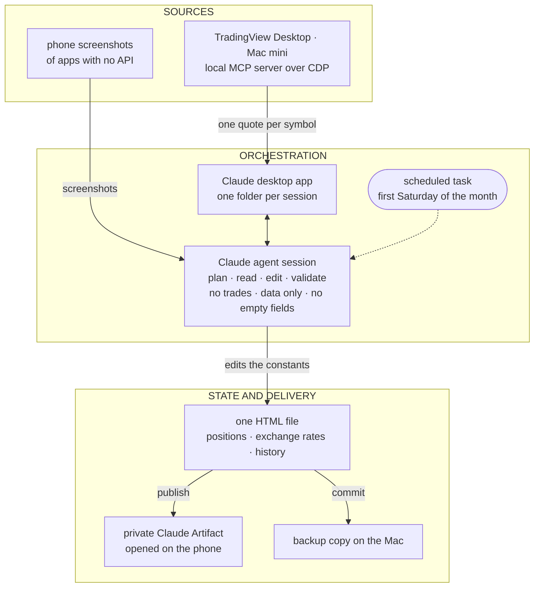
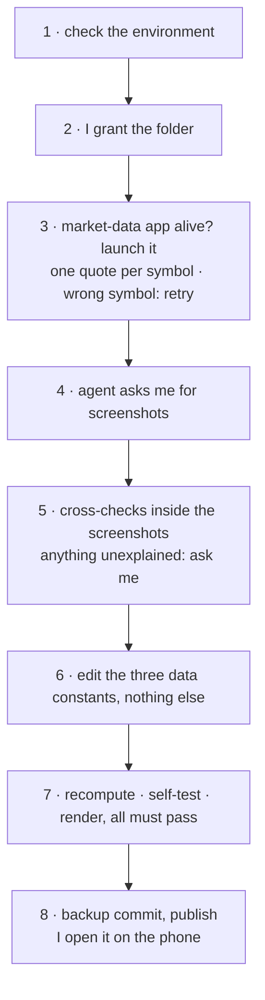

![An illustration in two halves, with fictional data. On the left, under the word BEFORE, a phone with six made-up finance apps — Alpha Bank, Beta Brokerage, Gamma Pension, Dollar account, Delta Fixed Income and Epsilon Fund — each with its balance hidden, and beside it the question "How much do I have, in total?". An orange arrow, captioned "built only by conversing · updated once a month", leads to the right, under the word AFTER, to a phone with a single screen: "My portfolio", a consolidated total of R$ 250,000, a line rising month by month, a bar split by asset class (fixed income, stocks, pension, cash) and a badge reading "4 checks passed".](/illustrations/build-your-first-ai-app-cover.en.jpg "Before: one app per institution, and none that adds it all up. After: one screen. The numbers are made up.")

If your money sits in more than one place, you know the gesture. Open the bank's app, then the brokerage's, then the pension's, then the dollar account. Each one shows a piece. None shows the whole. And the simplest question — how much do I have, in total, and did it go up or down? — turns into a spreadsheet nobody updates.

That was me. My money sits in several institutions, in more than one currency, and no aggregator covers all of them. Some have no API and no export: the balance screen in the phone app is the only source of truth there is.

What I wanted was boring: one consolidated view, a month-by-month history, a breakdown by asset class, and something I can open on the phone.

Today there is an investment app on my phone that sits in no app store. It shows the whole portfolio on one screen: the consolidated view, the month-by-month history, the breakdown by asset class. It is a page published as a private Claude Artifact, which I open in the Claude app on the phone. I did not write a line of it. The agent wrote the page, and the checks that validate the numbers, all from conversation.

## What you get

Three questions, one screen: how much I have, how it changed month by month, and where the money sits, by asset class. No opening five apps, no adding anything up in my head, nothing to install.

**Time.** The app updates once a month. Part of the numbers come from a market-data service; the rest come from screenshots I take of the apps on the phone itself. My part of an update is small on purpose: taking the screenshots of the balance screens, and answering whenever something stops and asks me. The rest — reading the numbers, updating the page, checking the sums, publishing — is the agent's.

**Clarity.** The history only grows. Each month becomes a new row, and the change from one month to the next is something I can read line by line, not a number that moved with no explanation.

**Trust.** A nice number on screen is worth nothing if it is wrong. What makes this app worth opening is four checks, which I explain in a moment, and which the agent wrote too.

**Want to see what it looks like?** I put together a sample version, with the same look as mine and a made-up portfolio — part in Brazil, part abroad:

**[Open the sample app →](https://claude.ai/artifact/DEdZjPSNRGYXA2UdbcPMzn)**

It opens in the browser or in the Claude app, on the phone. None of the numbers in it are mine. It is there for you to poke at and decide whether you want one.

You can build your own only by conversing, and the prompt for it is at the end of this piece. Building it is the easy part. The hard part shows up on the first update: how do you know that what the agent read is what was there, and that what it returned is right?

The first price after the market-data app launched came back for the wrong symbol.

Nothing crashed. The call returned a price. The agent caught it because it did not read the price first. It read the ticker that came with it, saw that it did not match what it had asked for, and asked again.

That habit is what makes the app worth trusting. The rest of this piece is what I built around it so I never have to take the agent's word for a number.

One limit before you reach it on your own: my app is private, so nothing below opens a file of mine you can inspect. What follows is testimony. What I can give you is the shape of the checks, the moments they paid for themselves, and the sample above so you can see the result.

## Checked, not trusted

This is the part I care about.

An agent reading a screenshot is reading pixels. An agent asking for a price is receiving whatever the tool decided to send. Neither one is the truth; both are input. So no number goes into the app on the agent's word alone. There are four checks, and each one catches something the others cannot.

**1. The source checks itself.** Before a number from a screenshot counts, it has to agree with another number on the same screen. A fund's balance must equal the amount invested plus the yield the app reports, to the cent. A stock line must equal quantity times the price that just came back. A government-run fund's total must equal the sum of its sub-accounts. If the model misreads one digit, the sum stops closing, and the update stops with it. *What you get: a misread digit does not become a wrong number on your phone.*

**2. Something that is not the agent adds it up.** A separate program, which the agent wrote when I asked, recomputes the totals and the per-class figures from the data and compares them with the new row the agent wrote. The agent writes the row; something else does the arithmetic. *What you get: the total does not depend on the agent having added correctly.*

**3. The check proves itself.** The same program then runs against last month's version and has to reach the total recorded then. If it cannot, its answer for this month means nothing: a check that has never been seen agreeing with a known answer is an opinion with a program attached. So it runs twice — once on this month, and once on a month whose answer I already know. *What you get: the check does not pass by accident.*

**4. The page has to open.** One last check, also written by the agent when I asked, opens the file and confirms there are no errors, and that the expected number of charts and table rows are there. *What you get: you do not find a broken app at the moment you want to look.*

```mermaid
flowchart TB
  accTitle: The gates a monthly update passes before it is published
  accDescr: A top-to-bottom pipeline. Inputs go to the screenshot cross-checks, then to the edit of the data constants, then to an independent Node recompute, then to a validator self-test against last month, then to a jsdom render check, and finally to publish and backup. Each of the four gates has its own branch that reads fail, stop and ask, and all four lead to one box: me, the human in the loop. One dashed branch, from the cross-checks to that same box, reads policy relaxed: outflows from one cash account no longer stop the run.
  IN["inputs<br/>screenshots · quotes"]
  G1["cross-checks<br/>inside the screenshots"]
  ED["edit the data constants"]
  G2["independent recompute<br/>Node"]
  G3["validator self-test<br/>reproduces last month"]
  G4["render check<br/>jsdom"]
  PB["publish + backup"]
  HU(["human in the loop · me"])
  IN --> G1 --> ED --> G2 --> G3 --> G4 --> PB
  G1 -- "fail: stop and ask" --> HU
  G2 -- "fail: stop and ask" --> HU
  G3 -- "fail: stop and ask" --> HU
  G4 -- "fail: stop and ask" --> HU
  G1 -. "policy relaxed · one cash account's outflows<br/>no longer stop the run" .-> HU
```

The habit behind the wrong symbol at the top of this piece runs through all four: what a tool returns gets checked, not trusted. I wrote [in another piece](/en/blog/three-agent-loops-one-month) about catching myself believing we got things right on the first try far more often than we did. These checks are that lesson, built into a Saturday.

## The human in the loop, tuned to what happened

The agent's rules are short. No trades, ever: it only reads and updates the page. It may touch the data only, never the look. No history row with an empty field.

And one rule I wrote before the first update and had to change: any unexplained drop in a fixed-income balance stopped everything and asked me.

The first time, it fired on a cash-like account. The drop was real, and normal: that account moves money in and out every month by design. I confirmed it, and the rule was relaxed for that account alone. Every other drop still stops the update.

I could not have written that rule correctly on day one; I would have been guessing. It is a small example of something larger: tuning when the agent stops and asks you to real behaviour, instead of guessing it upfront.

So, a question for you. The rules your agent asks you to confirm — did you write them before it ever ran, or after?

One more stop worth telling. An update stalled on a guard my workstation had at the time, one that halted a session after its configuration changed. The rule was to stop and tell me, not to find a way around it, and that is what happened. That guard has since been removed.

## What broke, and what is still crude

**Scheduling is not the same as reliability.** The October scheduled update did not execute. It ran by hand, from a handoff note.

Everything depends on the Mac being awake with the market-data app open. On the update this piece describes it was closed, and the agent launched it.

The screenshots are still manual. The open item is an inbox the phone feeds on its own. Moving the data into the Artifact's own storage is deferred too, because it means rewriting the part that draws the page.

And all the data lives inside one file that the agent writes and I do not. It is crude. At this scale — one person, one row a month — it beats a database: every month is a difference I can read line by line, the file opens anywhere with nothing installed, and a program checks it all by simply reading three blocks of data.

## Under the hood, for whoever wants to go down

This section is for anyone who wants to know how the pieces fit. Nothing in the others depends on it.

The pieces, in plain terms:

- **The orchestrator** is a Claude agent session in a cloud Linux workspace, on Claude Cowork's cloud side. It plans, calls tools, edits the data and checks the result. I follow it from the Claude app on the phone.
- **The bridge** is the Claude desktop app on a Mac mini. Each session, I approve access to one folder. Inside it the agent can run commands, commit files and reach the local MCP servers.
- **Prices** come from TradingView Desktop, driven by a local MCP server over the Chrome DevTools Protocol (CDP). The agent asks for one quote per symbol, and reads the response's `symbol` field before the price. Value is quantity times last price; cost only changes on a real transaction.
- **Balances with no price** come from phone screenshots of each app, read by the model.
- **The state** is a single HTML file with the charting library inlined. Three constants hold the data — positions, exchange rates, and a history that only ever grows — and only those three may change. Layout, charts and categories are frozen.
- **Checks 2 and 3** are a Node script; **check 4** is a render check in jsdom, with the canvas stubbed out.

It goes out as a private Claude Artifact, the local file stays as a backup, and a scheduled task fires on the first Saturday of each month.

## Build your own

The app is the part that makes you want to build one. The checks are what let you open it on your phone without doubting what you see.

> **Four checks to trust an app an agent updates:** make the source check itself before the model's reading counts; have something that is not the agent add it up; prove that something against a known answer before you believe it; check that the page still opens. And tune when the agent stops and asks you to a real update, instead of guessing it upfront.

The prompt below is for someone who has never programmed. Copy it, paste it into a new conversation with Claude, and replace what sits in square brackets. It starts with made-up data, so you see the app before you show it any number of yours. It does not use TradingView: everything comes from your screenshots. And when you send a screenshot, crop out the account number and your name; the agent only needs the balance.

**Before you paste it, what you need:**

- **A Claude account. The Free plan is enough.** Artifacts work on every plan, Free included. They need "code execution and file creation" (called "Create and edit files" in the newer Settings layout) turned on in Settings > Capabilities; check it before you start. Anthropic's own page: [what Artifacts are](https://support.claude.com/en/articles/17153992-what-are-artifacts-and-how-do-i-use-them).
- **The Claude app on your phone**, where you open your own app once the agent has built it as an Artifact. Sharing it by link is a different thing, and it depends on your plan: see [Anthropic's page on sharing](https://support.claude.com/en/articles/9547008-share-artifacts).
- **Screenshots of the balance screens** of your apps, taken on the phone. They are the only data the prompt uses.
- **No code.** You write none of it; the agent writes the page and the checks, the way it wrote mine.

**What this version does not do, said before you find out:**

- **No automatic prices.** It connects to no market-data service. Every number comes from a screenshot you send.
- **No update on its own.** The prompt sets up no schedule, and your Artifact does not update itself. Each month, go back to the same conversation and send the new screenshots.
- **It reads pixels.** The model can misread a digit. The checks exist to stop the update when that happens; they do not make the reading perfect.
- **It never touches your money.** It only reads and updates the page: no purchases, no transfers, and it never asks for a password or a login.
- **The sample link lives on claude.ai**, and that link may change.
- **Keep yours private.** Your app holds your real numbers. Do not share its link; the only one I shared is the sample, with made-up data.

**To reproduce my exact setup instead**, with prices and a monthly run that starts by itself, the prompt is not enough. You also need what *Under the hood* describes: the Claude desktop app on a computer that stays on (in my case a Mac mini), granting one folder per session; an agent session on Claude Cowork's cloud side; TradingView Desktop open on that computer, behind a local MCP server that drives it over CDP (mine is [tradingview-mcp](https://github.com/tradesdontlie/tradingview-mcp), an open project by a third party); and a scheduled task. **This one needs Claude Pro at minimum**: scheduled tasks in Cowork are on paid plans only (Pro, Max, Ultra, Team, Enterprise), per [Anthropic's page on them](https://support.claude.com/en/articles/13854387-schedule-recurring-tasks-in-claude-cowork). TradingView Desktop is available on TradingView's free plan, per [TradingView's own blog](https://www.tradingview.com/blog/en/multi-monitor-support-free-on-desktop-app-31209/). It carries the limits in *What broke*: the Mac has to be awake with TradingView open, a scheduled run has already failed to execute, and the screenshots are still manual.

> I want to build a simple app to track my investments on my phone. I do not know how to program, so do all of it for me and only explain what I need to decide.
>
> **What the app shows, on one screen:** the total of everything I have, adding up all my accounts; a month-by-month history; and the split by type of investment, for example [fixed income, stocks, pension, cash]. Amounts in [US dollars].
>
> **How it works:**
>
> 1. Build a single page as an Artifact, so I can open it in the Claude app on my phone.
> 2. Keep the data separate from the look. From one month to the next, only the data changes.
> 3. Start with made-up data for [three sample accounts, such as Example Bank, Example Brokerage and Example Pension], so I can see how it looks.
> 4. Once a month I will send you screenshots of the balance screens in my apps. Read the numbers in each screenshot.
> 5. Before you accept a number from a screenshot, check that it agrees with another number on the same screen, for example balance equals amount invested plus yield. If it does not, stop and ask me.
> 6. After updating, redo the sums a different way, without trusting what you yourself wrote, and show me whether the totals match.
> 7. Before you trust that check, also run it on the previous month and show that it reaches the total already recorded.
> 8. Check that the page still opens without errors before you hand it to me.
> 9. If any balance drops with no explanation, stop and ask me before you continue.
>
> **Rules that always apply:** you only read and update the page. Never make purchases, sales, transfers or any transaction. Never ask me for a password, a login or access to any app; I only send screenshots.

This week, paste that prompt into Claude, look at the app with the made-up data, and only then swap in one number of yours — one you only see today by opening an app on your phone.

A hug, and see you next time.

This is what I think.
