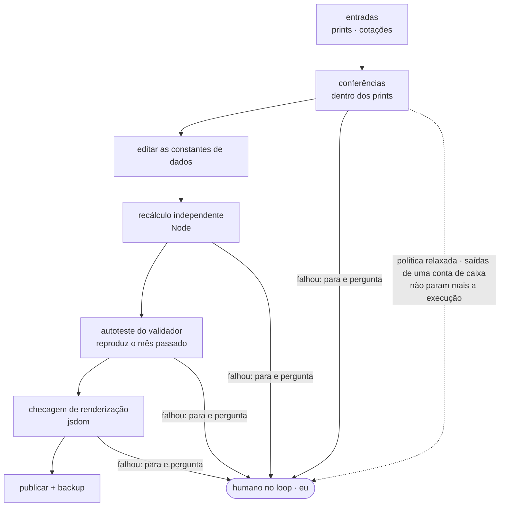
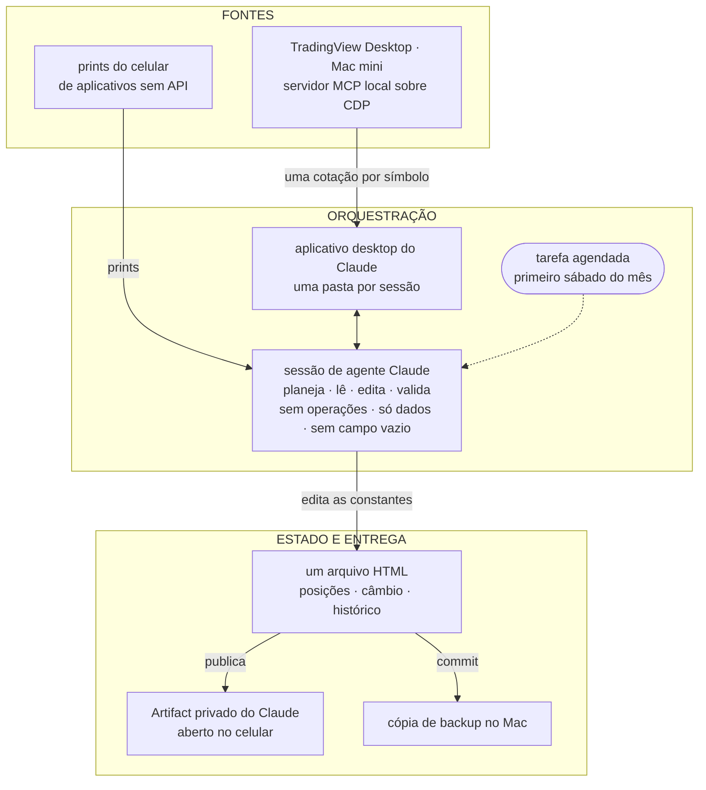
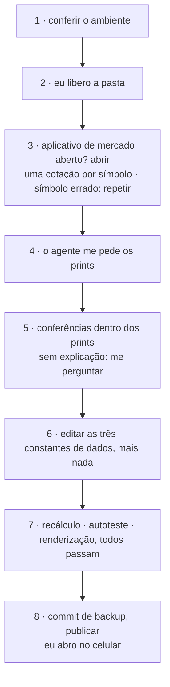

![Ilustração em duas metades, com dados fictícios. À esquerda, sob a palavra ANTES, um celular com seis aplicativos financeiros inventados — Banco Alfa, Corretora Beta, Previdência Gama, Conta em dólar, Renda fixa Delta e Fundo Épsilon — cada um com o saldo escondido, e ao lado a pergunta "Quanto eu tenho, ao todo?". Uma seta laranja, com a legenda "feito só conversando · atualizado uma vez por mês", leva à direita, sob a palavra DEPOIS, a um celular com uma tela só: "Meu portfólio", um total consolidado de R$ 250.000, uma linha subindo mês a mês, uma barra dividida por classe (renda fixa, ações, previdência, caixa) e um selo "4 conferências passaram".](/illustrations/build-your-first-ai-app-cover.pt.jpg "Antes: um aplicativo por instituição, e nenhum que some tudo. Depois: uma tela só. Os números são inventados.")

Se o seu dinheiro está em mais de um lugar, você conhece esse gesto. Abre o aplicativo do banco, depois o da corretora, depois o da previdência, depois a conta em dólar. Cada um mostra um pedaço. Nenhum mostra o todo. E a pergunta mais simples — quanto eu tenho, ao todo, e isso subiu ou desceu? — vira uma planilha que ninguém atualiza.

Era assim comigo. O meu dinheiro está em várias instituições, em mais de uma moeda, e nenhum agregador cobre todas. Algumas não têm API nem exportação: a tela de saldo no aplicativo do celular é a única fonte de verdade que existe.

O que eu queria era sem graça: uma visão consolidada, um histórico mês a mês, uma divisão por classe de ativo, e alguma coisa que eu abra no celular.

Hoje tem um app de investimentos no meu celular que não está em loja nenhuma. Ele mostra o portfólio inteiro numa tela só: a visão consolidada, o histórico mês a mês, a divisão por classe de ativo. É uma página publicada como um Artifact privado do Claude, que eu abro no aplicativo do Claude no celular. Eu não escrevi uma linha dela. O agente escreveu a página, e as conferências que validam os números, tudo a partir de conversa.

## O que você ganha

Três perguntas, uma tela: quanto eu tenho, como isso mudou mês a mês, e onde o dinheiro está, por classe de ativo. Sem abrir cinco aplicativos, sem somar nada de cabeça, sem instalar nada.

**Tempo.** O app se atualiza uma vez por mês. Parte dos números vem de um serviço de cotações; o resto, de prints que eu tiro dos aplicativos no próprio celular. A minha parte numa atualização é pequena de propósito: tirar os prints das telas de saldo e responder quando alguma coisa para e me pergunta. O resto — ler os números, atualizar a página, conferir as contas, publicar — é do agente.

**Clareza.** O histórico só cresce. Cada mês vira uma linha nova, e a mudança de um mês para o outro é algo que eu consigo ler linha por linha, não um número que mudou sem explicação.

**Confiança.** Um número bonito na tela não vale nada se estiver errado. O que faz esse app merecer ser aberto são quatro conferências, que eu explico já já, e que o agente também escreveu.

**Quer ver como fica?** Eu montei uma versão de exemplo, com o mesmo visual do meu, e um portfólio inventado — uma parte no Brasil, uma parte fora:

**[Abra o app de exemplo →](https://claude.ai/artifact/DEdZjPSNRGYXA2UdbcPMzn)**

Abre no navegador ou no aplicativo do Claude, no celular. Nenhum número ali é meu. É para você mexer e decidir se quer um desses.

Você consegue montar o seu só conversando, e no fim deste texto tem o prompt para isso. Montar é a parte fácil. A difícil aparece na primeira atualização: como você sabe que o que o agente leu é o que estava lá, e que o que ele devolveu está certo?

A primeira cotação depois que o aplicativo de mercado abriu veio com o símbolo errado.

Nada quebrou. A chamada devolveu um preço. O agente percebeu porque não leu o preço primeiro. Ele leu o código do ativo que veio junto, viu que não batia com o que tinha pedido, e pediu de novo.

Esse hábito é o que faz o app merecer confiança. O resto deste texto é o que eu construí em volta dele para nunca precisar acreditar na palavra do agente sobre um número.

Um limite antes que você chegue nele por conta própria: o meu app é privado, então nada aqui embaixo abre um arquivo meu que você possa inspecionar. O que vem a seguir é testemunho. O que eu consigo te dar é o formato das conferências, os momentos em que elas se pagaram, e o exemplo acima para você ver o resultado.

## Conferido, não confiado

Esta é a parte que me importa.

Um agente lendo um print está lendo pixels. Um agente consultando uma cotação está recebendo o que a ferramenta resolveu mandar. Nenhum dos dois é a verdade; os dois são entrada. Então nenhum número entra no app só pela palavra do agente. São quatro conferências, e cada uma pega uma coisa que as outras não pegam.

**1. A fonte se confere sozinha.** Antes de um número de um print contar, ele tem que bater com outro número da mesma tela. O saldo de um fundo tem que ser igual ao valor aplicado mais o rendimento que o aplicativo mostra, no centavo. Uma linha de ação tem que ser igual à quantidade vezes o preço que acabou de chegar. O total de um fundo administrado pelo governo tem que ser igual à soma das suas subcontas. Se o modelo lê um dígito errado, a soma para de fechar, e a atualização para junto. *O que você ganha: um erro de leitura não vira um número errado no seu celular.*

**2. Algo que não é o agente faz a conta.** Um programa separado, que o agente escreveu a meu pedido, refaz os totais e os números por classe a partir dos dados e compara com a linha nova que o agente escreveu. O agente escreve a linha; outra coisa faz a aritmética. *O que você ganha: o total não depende de o agente ter somado certo.*

**3. A conferência se prova.** O mesmo programa roda depois contra a versão do mês passado e tem que chegar no total que ficou registrado naquela época. Se não chegar, a resposta dele para este mês não vale nada: uma conferência que nunca foi vista concordando com uma resposta conhecida é uma opinião com um programa do lado. Então ela roda duas vezes — uma vez neste mês, e uma vez num mês cuja resposta eu já sei. *O que você ganha: a conferência não passa por acaso.*

**4. A página tem que abrir.** Uma última checagem, também escrita pelo agente a meu pedido, abre o arquivo e confirma que não tem erro, e que estão lá o número esperado de gráficos e de linhas de tabela. *O que você ganha: você não descobre um app quebrado na hora em que quer olhar.*

O hábito por trás do símbolo errado lá do começo atravessa as quatro: o que a ferramenta devolve se confere, não se confia. Eu escrevi [em outro texto](/pt/blog/tres-loops-de-agentes-um-mes) sobre me pegar acreditando que a gente acertava de primeira muito mais do que acertava de verdade. Essas conferências são essa lição, montada dentro de um sábado.

## O humano no loop, ajustado ao que aconteceu

As regras do agente são curtas. Nenhuma operação, nunca: ele só lê e atualiza a página. Ele só pode mexer nos dados, nunca no visual. Nenhuma linha de histórico com campo vazio.

E uma regra que eu escrevi antes da primeira atualização e tive que mudar: qualquer queda sem explicação num saldo de renda fixa parava tudo e me perguntava.

Na primeira vez ela disparou numa conta tipo caixa. A queda era real, e normal: aquela conta movimenta dinheiro para dentro e para fora todo mês, por desenho. Eu confirmei, e a regra foi relaxada só para aquela conta. Qualquer outra queda continua parando a atualização.

Eu não teria conseguido escrever essa regra certa no primeiro dia; eu estaria chutando. É um exemplo pequeno de uma coisa maior: ajustar quando o agente para e te pergunta ao comportamento real, em vez de chutar isso de antemão.

Então, uma pergunta para você. As regras que o seu agente te pede para confirmar — você escreveu antes de ele rodar alguma vez, ou depois?

Mais uma parada que vale contar. Uma atualização travou num guard que a minha workstation tinha na época, que parava uma sessão depois que a configuração dela mudava. A regra era parar e me avisar, não achar um jeito de contornar, e foi o que aconteceu. Esse guard já foi removido.

## O que quebrou, e o que ainda é tosco

**Agendar não é a mesma coisa que confiabilidade.** A atualização agendada de outubro não rodou. Ela foi feita na mão, a partir de uma nota de handoff.

Tudo depende do Mac estar acordado com o aplicativo de cotações aberto. Na atualização que este texto descreve ele estava fechado, e o agente abriu.

Os prints ainda são manuais. O item em aberto é uma caixa de entrada que o celular alimenta sozinho. Levar os dados para o armazenamento do próprio Artifact também ficou para depois, porque isso significa reescrever a parte que desenha a página.

E os dados inteiros vivem dentro de um arquivo que o agente escreve e eu não. É tosco. Nesta escala — uma pessoa, uma linha por mês — ganha de um banco de dados: cada mês é uma diferença que eu leio linha por linha, o arquivo abre em qualquer lugar sem instalar nada, e um programa confere tudo só lendo três blocos de dados.

## Por dentro, para quem quer descer

Esta seção é para quem quer saber como as peças se encaixam. Nada nas outras depende dela.

As peças, em português claro:

- **O orquestrador** é uma sessão de agente Claude num workspace Linux na nuvem, na parte cloud do Claude Cowork. Ele planeja, chama ferramentas, edita os dados e confere o resultado. Eu acompanho pelo aplicativo do Claude no celular.
- **A ponte** é o aplicativo desktop do Claude num Mac mini. A cada sessão, eu aprovo o acesso a uma pasta. Dentro dela o agente pode rodar comandos, fazer commit de arquivos e chegar nos servidores MCP locais.
- **As cotações** vêm do TradingView Desktop, controlado por um servidor MCP local sobre o Chrome DevTools Protocol (CDP). O agente pede uma cotação por símbolo, e lê o campo `symbol` da resposta antes do preço. Valor é quantidade vezes último preço; o custo só muda numa transação de verdade.
- **Os saldos sem cotação** vêm de prints dos aplicativos no celular, lidos pelo modelo.
- **O estado** é um único arquivo HTML com a biblioteca de gráficos embutida. Três constantes guardam os dados — posições, câmbio, e um histórico que só cresce — e só essas três podem mudar. Layout, gráficos e categorias estão congelados.
- **As conferências 2 e 3** são um script Node; **a 4** é uma checagem de renderização no jsdom, com o canvas substituído por um stub.

Ele sai como um Artifact privado do Claude, o arquivo local fica de backup, e uma tarefa agendada dispara no primeiro sábado de cada mês.

## Monte o seu

O app é a parte que dá vontade de montar. As conferências são o que deixa você abrir ele no celular sem desconfiar do que está vendo.

> **Quatro conferências para confiar num app que um agente atualiza:** faça a fonte se conferir antes de a leitura do modelo contar; tenha algo que não é o agente fazendo a conta; prove esse algo contra uma resposta conhecida antes de acreditar nele; confira que a página ainda abre. E ajuste quando o agente para e te pergunta a uma atualização de verdade, em vez de chutar de antemão.

O prompt abaixo é para quem nunca programou. Copie, cole numa conversa nova no Claude, e troque o que está entre colchetes. Ele começa com dados inventados, então você vê o app antes de mostrar qualquer número seu. Ele não usa o TradingView: tudo vem dos seus prints. E quando for mandar um print, corte o número da conta e o seu nome; o agente só precisa do saldo.

**Antes de colar, o que você precisa:**

- **Uma conta no Claude. O plano Free basta.** Artifacts funcionam em todos os planos, Free incluído. Eles precisam de "code execution and file creation" (chamado "Create and edit files" no layout novo de Settings) ligado em Settings > Capabilities; confira antes de começar. A página da própria Anthropic: [o que são Artifacts](https://support.claude.com/en/articles/17153992-what-are-artifacts-and-how-do-i-use-them).
- **O aplicativo do Claude no celular**, onde você abre o seu próprio app depois que o agente montar ele como um Artifact. Compartilhar por link é outra coisa, e depende do seu plano: veja [a página da Anthropic sobre compartilhar](https://support.claude.com/en/articles/9547008-share-artifacts).
- **Prints das telas de saldo** dos seus aplicativos, tirados no celular. Eles são o único dado que o prompt usa.
- **Nenhum código.** Você não escreve nada; o agente escreve a página e as conferências, como escreveu as minhas.

**O que esta versão não faz, dito antes de você descobrir:**

- **Nenhuma cotação automática.** Ela não se conecta a nenhum serviço de cotações. Todo número vem de um print que você manda.
- **Nenhuma atualização sozinha.** O prompt não agenda nada, e o seu Artifact não se atualiza sozinho. Todo mês, volte para a mesma conversa e mande os prints novos.
- **Ela lê pixels.** O modelo pode ler um dígito errado. As conferências existem para parar a atualização quando isso acontece; elas não deixam a leitura perfeita.
- **Ela nunca mexe no seu dinheiro.** Só lê e atualiza a página: nenhuma compra, nenhuma transferência, e ela nunca pede senha nem login.
- **O link do exemplo vive no claude.ai**, e esse link pode mudar.
- **Deixe o seu privado.** O seu app guarda os seus números de verdade. Não compartilhe o link dele; o único que eu compartilhei é o exemplo, com dados inventados.

**Para reproduzir exatamente a minha montagem**, com cotações e uma execução mensal que começa sozinha, o prompt não basta. Você precisa também do que *Por dentro* descreve: o aplicativo desktop do Claude num computador que fica ligado (no meu caso, um Mac mini), liberando uma pasta por sessão; uma sessão de agente na parte cloud do Claude Cowork; o TradingView Desktop aberto nesse computador, atrás de um servidor MCP local que controla ele sobre CDP (o meu é o [tradingview-mcp](https://github.com/tradesdontlie/tradingview-mcp), um projeto aberto de terceiros); e uma tarefa agendada. **Esta precisa do Claude Pro, no mínimo**: tarefas agendadas no Cowork só existem nos planos pagos (Pro, Max, Ultra, Team, Enterprise), segundo [a página da Anthropic sobre elas](https://support.claude.com/en/articles/13854387-schedule-recurring-tasks-in-claude-cowork). O TradingView Desktop está disponível no plano gratuito do TradingView, segundo [o blog do próprio TradingView](https://www.tradingview.com/blog/en/multi-monitor-support-free-on-desktop-app-31209/). Ela carrega os limites de *O que quebrou*: o Mac precisa estar acordado com o TradingView aberto, uma execução agendada já deixou de rodar, e os prints ainda são manuais.

> Quero criar um app simples para acompanhar meus investimentos no celular. Eu não sei programar, então faça tudo por mim e me explique só o que eu precisar decidir.
>
> **O que o app mostra, numa tela só:** o total de tudo o que eu tenho, somando todas as contas; um histórico mês a mês; e a divisão por tipo de investimento, por exemplo [renda fixa, ações, previdência, caixa]. Valores em [reais].
>
> **Como ele funciona:**
>
> 1. Monte uma página só como um Artifact, para eu abrir no aplicativo do Claude no celular.
> 2. Deixe os dados separados do visual. De um mês para o outro, só os dados mudam.
> 3. Comece com dados inventados para [três contas de exemplo, como Banco Exemplo, Corretora Exemplo e Previdência Exemplo], para eu ver como fica.
> 4. Uma vez por mês eu vou te mandar prints das telas de saldo dos meus aplicativos. Leia os números de cada print.
> 5. Antes de aceitar um número de um print, confira se ele bate com outro número da mesma tela, por exemplo saldo igual a valor aplicado mais rendimento. Se não bater, pare e me pergunte.
> 6. Depois de atualizar, refaça as contas de outro jeito, sem confiar no que você mesmo escreveu, e me mostre se os totais batem.
> 7. Antes de confiar nessa conferência, rode ela também no mês anterior e mostre que ela chega no total que já estava registrado.
> 8. Confira que a página ainda abre sem erro antes de me entregar.
> 9. Se algum saldo cair sem explicação, pare e me pergunte antes de continuar.
>
> **Regras que valem sempre:** você só lê e atualiza a página. Nunca faça compras, vendas, transferências ou qualquer operação. Nunca me peça senha, login ou acesso a nenhum aplicativo; eu só mando prints.

Esta semana, cole esse prompt no Claude, olhe o app com os dados inventados, e só depois troque por um número seu — um que hoje você só vê abrindo um aplicativo no celular.

Um abraço, e até a próxima.

Isso é o que eu penso.
