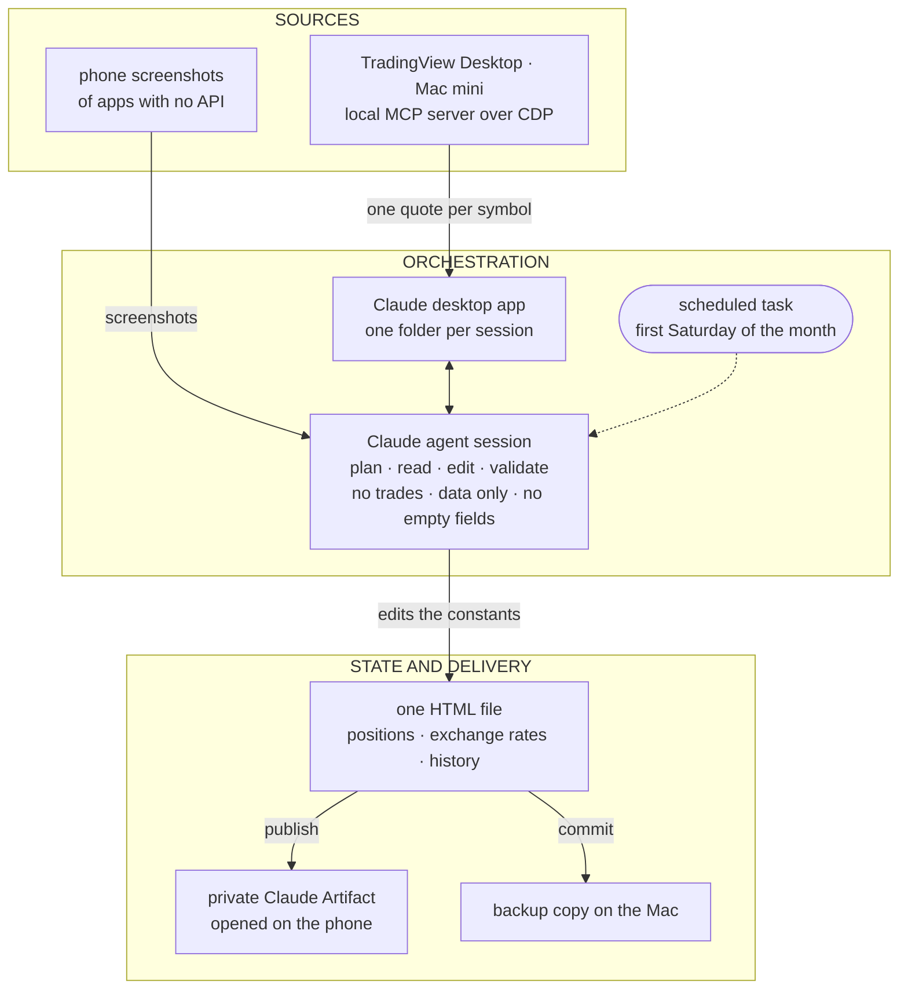
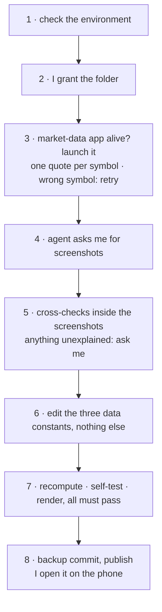
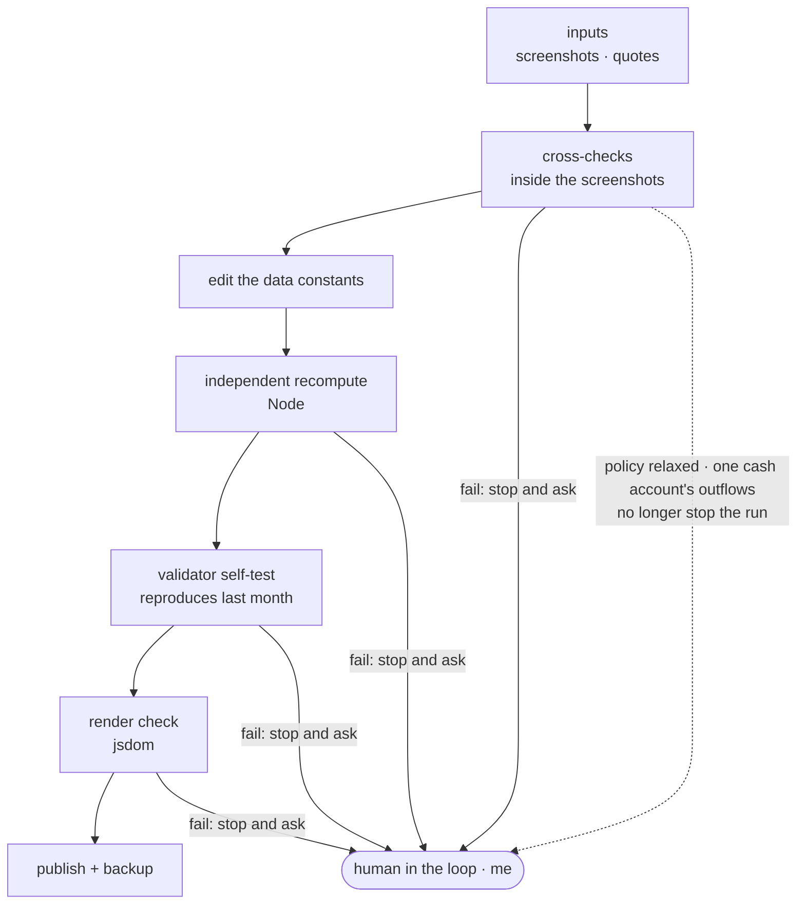

There is an investment app on my phone that sits in no app store. It shows the whole portfolio on one screen: the consolidated view, the month-by-month history, the breakdown by asset class. There is no new app to install. It is an HTML page, published as a private Claude Artifact, that I open in the Claude app on the phone.

Once a month, an agent updates that page. Part of the numbers come from TradingView, through an MCP server. The rest come from screenshots I take of the apps on the phone itself. The agent's session runs in the cloud, on Claude Cowork's cloud side, and works together with a Mac mini where TradingView stays open. I follow all of it from the Claude app on the phone.

You can build one of these. Building it is the easy part. The hard part shows up on the first update: how do you know that what the agent read is what was there, and that what it returned is right?

The first price after the market-data app launched came back for the wrong symbol.

Nothing crashed. The call returned a price. The agent caught it because it did not read the price first. It read the `symbol` field, saw that it did not match what it had asked for, and asked again.

That habit is what makes the app worth trusting. The rest of this piece is the app from the inside, and what I built around that habit so I never have to take the agent's word for a number.

One limit before you reach it on your own: the app is private, so nothing below opens a file you can inspect. What follows is testimony. What I can give you is the shape of the checks, and the moments they paid for themselves.

## Several apps, no API, one screen each

My money sits in several institutions, in more than one currency, and no aggregator covers all of them. Some have no API and no export. For those, the balance screen in the phone app is the only source of truth there is.

What I wanted was boring: one consolidated view, a month-by-month history, a breakdown by asset class, and something I can open on the phone.

The pieces, in plain terms:

- **The orchestrator** is a Claude agent session in a cloud Linux workspace. It plans, calls tools, edits the data and checks the result.
- **The bridge** is the Claude desktop app on a Mac mini. Each session, I approve access to one folder. Inside it the agent can run commands, commit files and reach the local MCP servers.
- **Prices** come from TradingView Desktop, driven by a local MCP server over the Chrome DevTools Protocol (CDP). The agent asks for one quote per symbol. Value is quantity times last price; cost only changes on a real transaction.
- **Balances with no price** come from phone screenshots of each app, read by the model.
- **The state** is a single HTML file with the charting library inlined. Three constants hold the data — positions, exchange rates, and a history that only ever grows — and only those three may change. Layout, charts and categories are frozen.

It goes out as a private Claude Artifact, the local file stays as a backup, and a scheduled task fires on the first Saturday of each month.

## One Saturday a month

My part of a run is small on purpose: the screenshots, and an answer whenever something stops and asks. The rest is the agent's, and most of the agent's part is checking itself.

## Checked, not trusted

This is the part I care about.

An agent reading a screenshot is reading pixels. An agent calling a tool is receiving whatever the tool decided to send. Neither one is the truth; both are input. So no number goes into the file on the agent's word alone. There are four layers, and each one catches something the others cannot.

**The source checks itself.** Before a number from a screenshot counts, it has to agree with another number on the same screen. A fund's balance must equal its cost plus the yield the app reports, to the cent. A stock line must equal quantity times the price TradingView just returned. A government-run fund's total must equal the sum of its sub-accounts. If the model misreads one digit, the sum stops closing, and the run stops with it.

**Something that is not the agent adds it up.** A separate Node script recomputes the totals and the per-class figures from the data constants and compares them with the new history row the agent wrote. The agent writes the row; something else does the arithmetic.

**The validator proves itself.** The same script then runs against last month's version of the file and has to reproduce the total recorded then. If it cannot, its answer for this month means nothing: a check that has never been seen agreeing with a known answer is an opinion with a script attached. So it runs twice — once on this month, and once on a month whose answer I already know.

**The page has to load.** A render check in jsdom, with the canvas stubbed out, opens the file: no script errors, and the expected number of charts and table rows.

The habit behind the wrong symbol at the top of this piece runs through all four layers. Tool output gets checked, not trusted: the agent compares what it asked for with what came back before it uses the answer. I wrote [in another piece](/en/blog/three-agent-loops-one-month) about catching myself believing we got things right on the first try far more often than we did. These checks are that lesson, built into a Saturday.

## The human in the loop, tuned to what happened

The guardrails are short. No trades, ever. Edits to the three data constants only. No history row with an empty field.

And one rule I wrote before the first run and had to change: any unexplained drop in a fixed-income balance stopped the run and asked me.

On the first run it fired on a cash-like account. The drop was real, and normal: that account moves money in and out every month by design. I confirmed it, and the rule was relaxed for that account alone. Every other drop still stops the run.

I could not have written that rule correctly on day one; I would have been guessing. It is a small example of something larger: tuning the human-in-the-loop policy to real behaviour, instead of guessing it upfront.

So, a question for you. The rules your agent asks you to confirm — did you write them before it ever ran, or after?

One more stop worth telling. A run stalled on a guard my workstation had at the time, one that halted a session after its configuration changed. The rule was to stop and tell me, not to find a way around it, and that is what happened. That guard has since been removed.

## What broke, and what is still crude

**Scheduling is not the same as reliability.** The October scheduled run did not execute. The update ran by hand, from a handoff note.

The pipeline depends on the Mac being awake with TradingView open. On the run this piece describes it was closed, and the agent launched it.

The screenshots are still manual. The open item is an inbox the phone feeds on its own. Moving the data into the Artifact's own storage is deferred too, because it means rewriting the rendering.

And the whole state lives as code, in one HTML file. It is crude. At this scale — one writer, one row a month — it beats a database: every month is a diff I can read line by line, the file opens anywhere with nothing installed, and a script validates it by simply reading three constants.

## What to take with you

The app is the part that makes you want to build one. The checks are what let you open it on your phone without doubting what you see.

> **Four checks to trust an app an agent updates:** make the source check itself before the model's reading counts; have something that is not the agent add it up; prove that something against a known answer before you believe it; check that the page still loads. And tune the human-in-the-loop rule to a real run instead of guessing it upfront.

This week, pick a number you only see today by opening an app on your phone, ask an agent to put it on a page, and recompute it with something that is not the agent. If you cannot recompute it, that is the first check to build.

A hug, and see you next time.

This is what I think.
