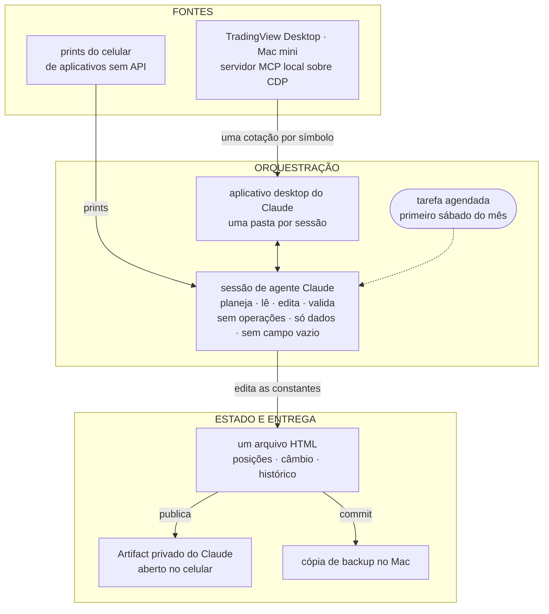
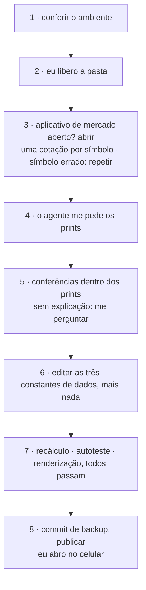
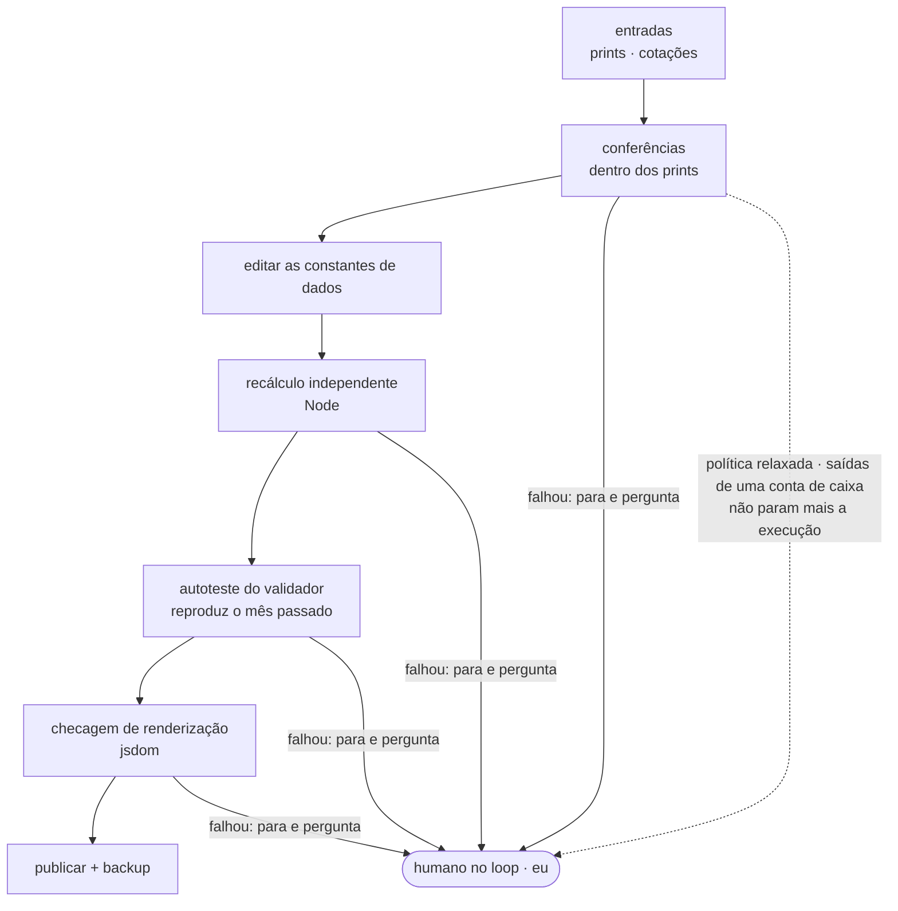

A primeira cotação depois que o aplicativo de mercado abriu veio com o símbolo errado.

Nada quebrou. A chamada devolveu um preço. O agente percebeu porque não leu o preço primeiro. Ele leu o campo `symbol`, viu que não batia com o que tinha pedido, e pediu de novo.

Essa troca é o artigo inteiro. Todo o resto aqui é o que eu construí em volta desse hábito.

O exemplo é pessoal: uma vez por mês, um agente atualiza um controle dos meus investimentos. O assunto não é dinheiro. É uma pergunta que toda pessoa que roda agentes encontra, cedo ou tarde: como você sabe que o que o agente leu é o que estava lá, e que o que ele devolveu está certo?

Um limite antes que você chegue nele por conta própria: o controle é privado, então nada aqui embaixo abre um arquivo que você possa inspecionar. O que vem a seguir é testemunho. O que eu consigo te dar é o formato das conferências, e os momentos em que elas se pagaram.

## Vários aplicativos, nenhuma API, uma tela cada

O meu dinheiro está em várias instituições, em mais de uma moeda, e nenhum agregador cobre todas. Algumas não têm API nem exportação. Para essas, a tela de saldo no aplicativo do celular é a única fonte de verdade que existe.

O que eu queria era sem graça: uma visão consolidada, um histórico mês a mês, uma divisão por classe de ativo, e alguma coisa que eu abra no celular.

As peças, em português claro:

- **O orquestrador** é uma sessão de agente Claude num workspace Linux na nuvem. Ele planeja, chama ferramentas, edita os dados e confere o resultado.
- **A ponte** é o aplicativo desktop do Claude num Mac mini. A cada sessão, eu aprovo o acesso a uma pasta. Dentro dela o agente pode rodar comandos, fazer commit de arquivos e chegar nos servidores MCP locais.
- **As cotações** vêm do TradingView Desktop, controlado por um servidor MCP local sobre o Chrome DevTools Protocol (CDP). O agente pede uma cotação por símbolo. Valor é quantidade vezes último preço; o custo só muda numa transação de verdade.
- **Os saldos sem cotação** vêm de prints dos aplicativos no celular, lidos pelo modelo.
- **O estado** é um único arquivo HTML com a biblioteca de gráficos embutida. Três constantes guardam os dados — posições, câmbio, e um histórico que só cresce — e só essas três podem mudar. Layout, gráficos e categorias estão congelados.

Ele sai como um Artifact privado do Claude, o arquivo local fica de backup, e uma tarefa agendada dispara no primeiro sábado de cada mês.

## Um sábado por mês

A minha parte numa execução é pequena de propósito: os prints, e uma resposta sempre que alguma coisa para e pergunta. O resto é do agente, e a maior parte da parte do agente é conferir a si mesmo.

## Conferido, não confiado

Esta é a parte que me importa.

Um agente lendo um print está lendo pixels. Um agente chamando uma ferramenta está recebendo o que a ferramenta resolveu mandar. Nenhum dos dois é a verdade; os dois são entrada. Então nenhum número entra no arquivo só pela palavra do agente. São quatro camadas, e cada uma pega uma coisa que as outras não pegam.

**A fonte se confere sozinha.** Antes de um número de um print contar, ele tem que bater com outro número da mesma tela. O saldo de um fundo tem que ser igual ao custo mais o rendimento que o aplicativo mostra, no centavo. Uma linha de ação tem que ser igual à quantidade vezes o preço que o TradingView acabou de devolver. O total de um fundo administrado pelo governo tem que ser igual à soma das suas subcontas. Se o modelo lê um dígito errado, a soma para de fechar, e a execução para junto.

**Algo que não é o agente faz a conta.** Um script Node separado recalcula os totais e os números por classe a partir das constantes de dados e compara com a linha nova de histórico que o agente escreveu. O agente escreve a linha; outra coisa faz a aritmética.

**O validador se prova.** O mesmo script roda depois contra a versão do mês passado do arquivo e tem que reproduzir o total registrado naquela época. Se não conseguir, a resposta dele para este mês não vale nada: uma conferência que nunca foi vista concordando com uma resposta conhecida é uma opinião com um script do lado. Esse é o «duas vezes» do título — uma vez neste mês, e uma vez num mês cuja resposta eu já sei.

**A página tem que carregar.** Uma checagem de renderização no jsdom, com o canvas substituído por um stub, abre o arquivo: nenhum erro de script, e o número esperado de gráficos e de linhas de tabela.

O hábito por trás do símbolo errado lá do começo atravessa as quatro camadas. Saída de ferramenta se confere, não se confia: o agente compara o que pediu com o que voltou antes de usar a resposta. Eu escrevi [em outro texto](/pt/blog/tres-loops-de-agentes-um-mes) sobre me pegar acreditando que a gente acertava de primeira muito mais do que acertava de verdade. Essas conferências são essa lição, montada dentro de um sábado.

## O humano no loop, ajustado ao que aconteceu

Os guardrails são curtos. Nenhuma operação, nunca. Edição só nas três constantes de dados. Nenhuma linha de histórico com campo vazio.

E uma regra que eu escrevi antes da primeira execução e tive que mudar: qualquer queda sem explicação num saldo de renda fixa parava a execução e me perguntava.

Na primeira execução ela disparou numa conta tipo caixa. A queda era real, e normal: aquela conta movimenta dinheiro para dentro e para fora todo mês, por desenho. Eu confirmei, e a regra foi relaxada só para aquela conta. Qualquer outra queda continua parando a execução.

Eu não teria conseguido escrever essa regra certa no primeiro dia; eu estaria chutando. É um exemplo pequeno de uma coisa maior: ajustar a política de human-in-the-loop ao comportamento real, em vez de chutar ela de antemão.

Então, uma pergunta para você. As regras que o seu agente te pede para confirmar — você escreveu antes de ele rodar alguma vez, ou depois?

Mais uma parada que vale contar. Uma execução travou num guard que a minha workstation tinha na época, que parava uma sessão depois que a configuração dela mudava. A regra era parar e me avisar, não achar um jeito de contornar, e foi o que aconteceu. Esse guard já foi removido.

## O que quebrou, e o que ainda é tosco

**Agendar não é a mesma coisa que confiabilidade.** A execução agendada de outubro não rodou. A atualização foi feita na mão, a partir de uma nota de handoff.

O pipeline depende do Mac estar acordado com o TradingView aberto. Na execução que este texto descreve ele estava fechado, e o agente abriu.

Os prints ainda são manuais. O item em aberto é uma caixa de entrada que o celular alimenta sozinho. Levar os dados para o armazenamento do próprio Artifact também ficou para depois, porque isso significa reescrever a renderização.

E o estado inteiro vive como código, num arquivo HTML. É tosco. Nesta escala — uma pessoa escrevendo, uma linha por mês — ganha de um banco de dados: cada mês é um diff que eu leio linha por linha, o arquivo abre em qualquer lugar sem instalar nada, e um script valida tudo só lendo três constantes.

## O que levar daqui

> **Três coisas para levar daqui:** faça a fonte se conferir antes de a leitura do modelo contar; tenha algo que não é o agente fazendo a conta, e prove esse algo contra uma resposta conhecida antes; ajuste a regra de human-in-the-loop a uma execução de verdade, em vez de chutar ela de antemão.

Esta semana, escolha um número que um agente te deu e recalcule com alguma coisa que não seja o agente. Se você não conseguir, essa é a primeira conferência a construir.

Um abraço, e até a próxima.

Isso é o que eu penso.
