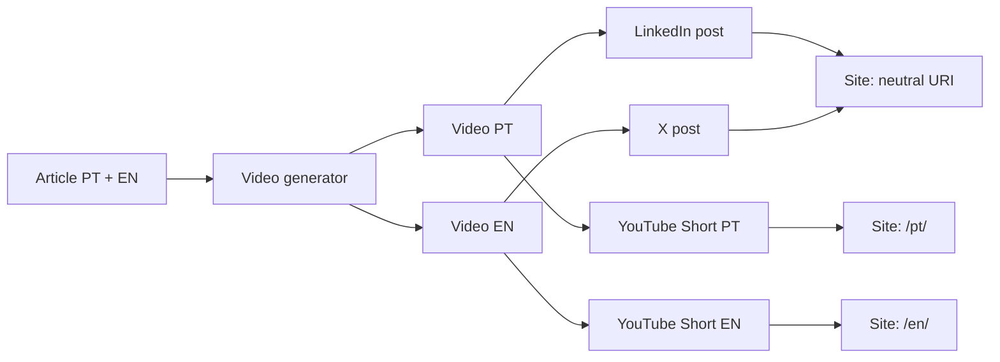

# tadeumendonca-io — product requirements document: communication and channel strategy

- **Status:** agreed in interview, 2026-11-20; open decisions listed at the end
- **Subject:** `communication-channel-strategy`
- **Revises:** [ADR-0005, *Distribution to LinkedIn and X*](./adr/0005-og-coverage-every-public-url.md#distribution-to-linkedin-and-x) (which channels, and the post
  format; formerly record 0038); keeps [ADR-0036, *A neutral, self-canonical share URL per article*](./adr/0036-per-locale-urls-prerender-hreflang.md#a-neutral-self-canonical-share-url-per-article) for text posts
- **Next step:** `prd-to-issues`, when the owner asks for it

## Why

The site publishes one bilingual piece at a time and distributes it by hand to LinkedIn and X
(ADR-0005, *Distribution to LinkedIn and X*). The first measured period shows where that breaks. The figures come from
[`docs/funnel-review/sprint-07.md`](./funnel-review/sprint-07.md), consenting sessions only, about one
day of exposure:

- The LinkedIn post reached 126 members (200 impressions) and produced **1** link visit.
- The English edition got **0** measured readers. All 12 reading-progress events were Portuguese.
- Instagram and WhatsApp each brought 3 of 18 sessions, as many as LinkedIn. Neither is in ADR-0005, *Distribution to LinkedIn and X*.
  X brought 1.

The owner chose to rebuild the strategy from zero rather than tune the post format alone.

## Target behaviour

### 1. One audience

> Owner, translated: *"I need to define one target audience first, for the whole initiative: my peers in
> the IT industry, with more than ten years of career."*

Every channel, format and language rule below serves **IT-industry peers with 10+ years of career**.
A choice that serves another audience better and this one worse is the wrong choice.

### 2. Two objectives, held together

> Owner: *"1 and 3"*: reading on the site **and** audience on the networks.

- **Reading on the site**: visits and reading depth, measured per piece and per language.
- **Audience on the networks**: native reach and engagement on each platform.

The post format (section 5) is how the two coexist: the native post earns attention, the article earns
the read.

### 3. Channels

> Owner chose: *LinkedIn + X + YouTube.*

| Channel | Role | Authored by the owner |
| --- | --- | --- |
| LinkedIn | text + short video post; core of the Portuguese-speaking peer network | yes |
| X | text + short video post; the global, English-speaking technical conversation | yes |
| YouTube | two Shorts per piece, one per language | yes |
| Instagram, WhatsApp | reached only through the reader's own share from the site | no |
| LinkedIn newsletter | not in the portfolio (rejected with the "every channel" option) | no |

The obligation in ADR-0005, *Distribution to LinkedIn and X*, that a publication is incomplete until it exists on every authored channel
carries over to the new set: LinkedIn, X and YouTube, in the same batch.

### 4. Language

> Owner, translated: *"Portuguese and English on every platform, organised as single posts in text; video
> would have to be regionalised content."* · *"It varies per platform, while the web app has regionalised
> links for each supported language."* · *"We have the non-regionalised URI, with a default-language
> rule, and the specialised ones."*

- **Text is one bilingual post per platform.** The opening language varies per platform.
- **Video is one render per language.**
- **Text posts carry the neutral share URI** (`/blog/<en-slug>`, ADR-0036, *A neutral, self-canonical share URL per article*). The site resolves the
  language by its rule: path, then stored choice, then the edge hint (#669, #788), then the browser,
  then English.
- **The per-language URIs** (`/pt/…`, `/en/…`) serve the specialised cases: the per-language YouTube
  Shorts.

Agreed per-platform mix (owner chose the recommended mix):

| Platform | Text opens in | Video | Link |
| --- | --- | --- | --- |
| LinkedIn | Portuguese, English below | Portuguese render | neutral |
| X | English, Portuguese below | English render | neutral |
| YouTube | the video's language | two Shorts, PT and EN | per language |

Why: the owner's LinkedIn network is mostly Portuguese-speaking, so leading there in Portuguese keeps
that audience close; X carries the English presence.

### 5. Post format

> Owner, translated: *"Capturing traffic in LinkedIn and X posts has to catch attention with short videos,
> text with a teaser, and a link to the article."*

Each LinkedIn and X post is **a short video, a teaser text and the article link**. This replaces the
digest format (argument summarised, only the turn held back) for these two platforms.

### 6. Video: generated by the repository, narrated in a cloned voice

> Owner chose: *generated by the repository* · *synthetic narration* · *a clone of his own voice.*

- A repository script renders each short video from the article, once per language, the way the OG
  cards are generated today. No camera, no manual edit.
- Narration is synthetic speech in **a clone of the owner's voice**, one track per language.
- What leaves the repository is the rendered output, not the copy drafts, which stay private as
  ADR-0005, *Distribution to LinkedIn and X* requires.

### 7. Cadence

> Owner chose: *one piece per sprint.*

One complete piece every 14 days: the article in both locales, two video renders, and the LinkedIn,
X and YouTube posts. It lines up with the funnel-review rite.

### 8. Measurement

> Owner chose: *a three-sprint baseline before any target.*

- The funnel review measures, per channel and per language: reach, then visit, then reading depth.
- **No numeric target is set until three pieces have shipped** under this strategy. The target is then
  set from that baseline.
- Each post records the address it carried, so a post can be matched to its sessions (the change
  sprint-07's finding 1 asked for).

## Risks the owner accepted

- **The voice clone puts a sample of the owner's voice with a third party**, costs money per use, and
  needs a credential in whichever place the generator runs. A video speaks words he did not say aloud.
- **Teaser posts carry a link.** Platforms may rank link posts lower, which works against the audience
  objective. The three-sprint baseline is where this shows.
- **Unverified premise:** YouTube Shorts may not allow a clickable link in the description. If so,
  YouTube serves the audience objective only, not traffic to the site. Verify before building.
- **Cost per piece is now an article, a generated video pipeline and three platforms**, on a
  weekends-only schedule.

## Open decisions

Each is written as open, not guessed.

1. **Voice service and spending ceiling.** Which provider clones and synthesises the voice, and the
   monthly spend the owner authorises. No paid use starts before he sets it.
2. **Where the generator runs**: on the workstation or in the pipeline. This decides where the voice
   credential lives (the secrets standard applies).
3. **Video length and visual template**, within the fixed visual identity (ADR-0008).
4. **Posting stays manual and ask-first** (ADR-0005, *Distribution to LinkedIn and X*, the rejected option *Automating the fan-out*), or is automated. Not discussed.
5. **The owner-authored Instagram Stories work (#662)** no longer matches the channel set. The reader's
   share-to-Story (#789) still does. What happens to #662 is the owner's call; no agent closes it.
6. **The record.** ADR-0005, *Distribution to LinkedIn and X*, needs an amendment or a successor for the new channel set and the new
   format; that is the tech lead's to author once the owner confirms this document.
